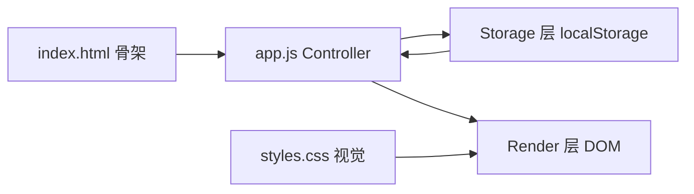

## 用户需求
用纯 HTML + CSS + JavaScript 实现一个简易社交信息流网页应用（作业要求“简单版微博/推特”），产品名为 **BigBo**。界面文案、代码、README 与仓库描述中**不得出现“微博 / Weibo / Twitter / tweet / 推特”等字样**，一律以“动态、时间线、信息流”等中性词表述。数据用 Local Storage 本地存储，保证最小可用。使用 Git 做版本管理，并把代码推送到 GitHub 公开远程仓库。

## Product Overview
BigBo 是一个单页、零依赖、双击 `index.html` 即可运行的极简社交信息流应用。用户在顶部发布框写下想法并发布，内容立即出现在下方时间线顶部；关闭或刷新浏览器后内容依然保留。整体是一屏即可完成“写—发—看”的闭环，适合课堂演示与作业评审。

## Core Features
- **发布动态**：多行输入框 + 发布按钮，输入为空时不可发布并给出提示；实时显示字数与上限（如 280 字），超限禁用发布；支持 Ctrl/Cmd + Enter 快捷发布；发布成功后输入框清空并弹出轻量成功提示。
- **时间线查看**：按发布时间**倒序**展示全部动态卡片（头像占位 + 昵称 + 相对时间 + 正文），最新动态出现在最上方。
- **本地持久化**：所有动态保存在浏览器 Local Storage 中，刷新、关闭再打开页面数据不丢失；数据损坏或不可用时自动降级为空列表并提示，不影响页面可用。
- **空状态与反馈**：无任何动态时展示引导性空状态；操作失败（如存储不可用）时给出明确提示。
- **视觉与响应式**：现代化的卡片式信息流界面，渐变主色、柔和阴影、悬停与入场动效；桌面端居中单列布局，窄屏自动适配为全宽移动端布局。

## 交付要求
- 文件组织为 `index.html` + `styles.css` + `app.js` 三文件分离。
- 提供 README（功能说明、运行方式、技术栈）。
- Git 分阶段提交（初始化 → 页面骨架 → 存储与发布 → 样式 → 文档），最终推送到 GitHub **公开仓库 bigbo**，并把仓库链接交给用户。


## Tech Stack
- 语言与运行环境：HTML5 + CSS3 + 原生 JavaScript（ES2020 语法，浏览器直接执行），**无框架、无构建工具、无外部依赖、不引 CDN**。
- 运行方式：直接双击 `index.html`，通过 `file://` 协议打开即可使用（因此**不使用 ES Module**，因为 `file://` 下 module 会被 CORS 拦截；`app.js` 用 `<script defer>` 普通脚本加载）。
- 数据存储：`window.localStorage`，单一 key 保存 JSON 数组。
- 版本管理：Git（默认分支 `main`）+ GitHub CLI（`C:\Program Files\GitHub CLI\gh.exe`，已登录 `xiaoxin1986`，SSH 协议，具备 `repo` 权限）。

## Implementation Approach
整体采用“三文件 + 单文件内分层”的轻量结构：`index.html` 只负责语义化骨架（头部、发布区、时间线容器、空状态、Toast 占位），`styles.css` 负责全部视觉与响应式，`app.js` 内部按 **Storage 层 → Utils 层 → Render 层 → Controller 层** 四个区块顺序组织并通过 IIFE 隔离全局，既保持“三文件”的简洁，又具备可读的职责边界。

关键决策与理由：
1. **数据模型极简**：`{ id, content, createdAt }`，`id` 用 `crypto.randomUUID()`（带时间戳+随机数兜底），`createdAt` 存毫秒时间戳，便于排序与格式化。
2. **读写容错优先**：读取时 `try/catch` 包裹 `JSON.parse`，校验结果 `Array.isArray` 并逐条过滤合法字段，异常则回退 `[]`；写入时 `try/catch` 捕获配额/隐私模式 `SecurityError`，失败即通过 Toast 告知用户而非静默丢数据。
3. **XSS 绝对防护**：动态正文、时间等一律通过 `document.createElement` + `textContent` 构建节点，**禁止**将用户输入拼接进 `innerHTML`；换行用 CSS `white-space: pre-wrap` 保留，避免使用 `innerHTML` 转义方案。
4. **渲染策略**：数据量小（本地单机），采用“全量重渲染时间线”策略，O(n) 复杂度，n 为动态条数，几十到几百条无性能压力；发布时先写存储再整体重渲染，保证 DOM 与存储始终一致（单一数据源原则），避免增量更新的状态漂移。
5. **可扩展预留**：Storage 层对外暴露 `getPosts / addPost`，后续加删除、点赞只需新增方法，不触碰渲染与控制器逻辑；版本化 key `bigbo.posts.v1` 便于将来迁移数据结构。

## Implementation Notes
- **时间显示**：`formatRelativeTime` 覆盖“刚刚 / n 分钟前 / n 小时前 / 昨天 / 具体日期”，超过 7 天显示 `YYYY-MM-DD`，同时给 `<time>` 标签设 `dateTime` 与 `title`（完整时间），兼顾可读性与可访问性。
- **输入校验**：`content.trim()` 后为空则不发；长度以 `Array.from(str).length`（按字符计）统计，与 `maxlength` 行为保持一致的视觉反馈；输入时同步更新字数与按钮禁用态。
- **提交防抖**：发布按钮在处理函数开头即禁用，处理完成后在 `finally` 中恢复，避免连点产生重复数据。
- **排序稳定性**：同一毫秒内多条动态按数组顺序保序，渲染前对副本 `sort((a,b)=>b.createdAt-a.createdAt)`，不直接修改存储原数组。
- **可访问性**：输入框配 `<label>`（可用 `.sr-only` 视觉隐藏）、按钮 `type="button"`、Toast 容器设 `role="status" aria-live="polite"`、焦点样式使用 `:focus-visible` 自定义描边。
- **Git 提交**：`gh` 不在 PATH，命令统一使用 `& "C:\Program Files\GitHub CLI\gh.exe"`；推送使用 `gh repo create bigbo --public --source=. --remote=origin --push`；所有提交信息使用语义化中文短句，逐阶段提交以体现 AI Coding 过程；`.gitignore` 忽略 `.DS_Store`、`Thumbs.db`、`.vscode/` 等本地产物。

## Architecture Design
单页应用，四层单向数据流：用户操作 → Controller 校验并调用 Storage 写入 → Storage 落盘后返回最新列表 → Controller 调用 Render 全量重绘 → DOM 呈现。



## Directory Structure
```
bigbo/
├── index.html    # [NEW] 页面骨架。含页头（BigBo 品牌标识与副标题）、发布区（label + textarea + 字数统计 + 发布按钮）、时间线区（<section> + 列表容器）、空状态容器、Toast 容器；通过 <link> 引入 styles.css，<script defer src="app.js">；不得出现任何受限品牌词。
├── styles.css    # [NEW] 全部视觉样式。CSS 变量定义色彩/圆角/阴影；渐变页头、卡片式动态、输入区聚焦态、按钮 hover/active 微动效、发布入场动画、空状态插画式排版、Toast 动画；响应式断点 640px 单列全宽适配；含 .sr-only、reduced-motion 适配。
├── app.js        # [NEW] 应用逻辑，IIFE 包裹。四区块：Storage（load/save/add，含 JSON 容错与写入异常处理，key = bigbo.posts.v1）、Utils（formatRelativeTime、字符计数、随机 id）、Render（renderTimeline 全量渲染、renderEmptyState、showToast，全部 textContent 构建）、Controller（DOM 引用、事件绑定：input 计数、button 发布、Ctrl/Cmd+Enter、init 首屏渲染）。
├── README.md     # [NEW] 项目说明。包含产品简介、核心功能列表、技术栈、本地运行方式（双击 index.html）、目录结构、数据存储说明（localStorage key 与数据结构）、浏览器兼容性；全篇使用中性产品表述，规避受限品牌词。
└── .gitignore    # [NEW] 忽略 .vscode/、Thumbs.db、.DS_Store 等本地环境产物。
```

## Key Code Structures
```js
// 单条动态的数据结构（存储于 localStorage 的 JSON 数组中）
/**
 * @typedef {Object} Post
 * @property {string} id        唯一标识，crypto.randomUUID() 或时间戳回退
 * @property {string} content   正文纯文本（渲染时仅用 textContent）
 * @property {number} createdAt 创建时间毫秒时间戳，用于倒序排序与相对时间显示
 */
```


## Design Style
采用 **Modern Glass + Aurora Gradient** 风格的轻量社交信息流设计：浅色雾面背景叠加柔和渐变光晕，内容以白色高光卡片承载，强调留白与层级，整体干净、轻盈、有呼吸感，但通过渐变主色、细腻阴影与微动效保证“第一眼高级”。

## Page Layout（单页，自上而下四个区块）
1. **顶部品牌栏**：左侧圆形渐变 Logo（字母 B）+ 产品名 BigBo 与一句副标题“记录此刻，分享所想”；右侧显示“本地存储”状态徽标，说明数据保存在本机。栏位吸顶，滚动时加毛玻璃模糊与细描边。
2. **发布卡片**：左上角头像占位（渐变圆环），下方为无边框多行输入区（占位文案引导“此刻在想什么？”），底部一行依次为字数统计（接近上限变橙、超限变红）、分隔细线、渐变实心圆角“发布”按钮；聚焦时卡片出现主色光晕描边。
3. **时间线区**：区块标题“最新动态”配数量徽标；每条动态为独立卡片，含小圆形头像（按 id 生成稳定的柔和渐变色）、昵称“BigBo 用户”、灰色相对时间、正文。卡片默认微投影，hover 时上浮 2px 并加深阴影，发布时新卡片带淡入+下滑入场动画。
4. **空状态**：无数据时居中展示线性图标 + “还没有任何动态” + 引导文案 + “发布第一条”次按钮（点击聚焦输入框）。
5. **Toast 提示**：底部居中胶囊浮层，成功为绿色、失败为红色，2.5 秒自动消失，仅一条避免堆叠。

## Interaction
输入即实时更新字数与按钮禁用态；Ctrl/Cmd+Enter 快捷发布；发布成功输入框清空、新动态插入列表顶部并滚动至可见；所有交互均配 150-250ms 缓动过渡，遵循 `prefers-reduced-motion` 降级。

## Responsiveness
桌面端内容最大宽度 640px 居中，两侧留呼吸边距；≤640px 时卡片取消外投影改为通栏浅描边，按钮变为更高触控高度（44px），页头文字缩小一级，整体单列纵向滚动。

## Restriction
全部字体使用系统字体栈，不加载外部字体与图标库；界面文案不含任何受限品牌词，图标使用内联 SVG 或 CSS 绘制。

## Agent Extensions
### Skill
- **agent-browser**
  - Purpose: 在提交前用真实浏览器打开本地 `index.html`（file:// 协议），验证页面渲染、发布动态、刷新后数据保留、空状态与字数校验等核心流程。
  - Expected outcome: 完成一次可复现的功能验收（发布 1-2 条动态并截图，刷新后内容仍在），确认 MVP 在真实浏览器中可用后再推送 GitHub。
